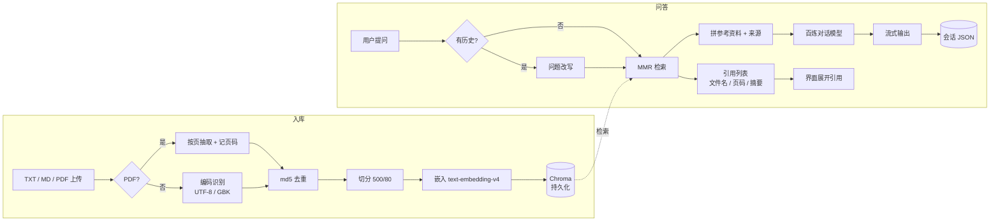

# ai-rag-agent · 企业知识库问答机器人

> 上传一份公司文档，就能得到一个只依据这份文档回答问题的客服机器人：答案带来源、查不到就说查不到、还能接着上一句追问。

**技术栈**：Python 3.13 · LangChain（LCEL）· Chroma · 阿里云百炼（对话 + 嵌入，模型名在 `.env` 配置）· Streamlit

---

## 它是什么

一个**可运行的 RAG（检索增强生成）应用**，不是 demo 片段：

- 左边上传文档 → 自动切分、向量化、落盘建库；
- 右边多轮对话 → 先检索资料，再让大模型**只依据资料**作答；
- 文档里没有的内容，它会明确说"知识库中未找到"，而不是编一个答案；
- 追问"那运费谁出？"时，会先把问题补全成"星海手环的运费由谁承担"，再去检索。

一段真实对话长这样：

```
用户：你们的退换货政策是什么？
助手：签收后 7 天内可无理由退货；质量问题产生的运费由公司承担。
      （来源：星海科技-产品服务手册.txt）

用户：那运费谁出？                 ← 指代句，直接检索是搜不到东西的
助手：质量问题由公司承担，非质量问题的退回运费由客户承担。
      （来源：星海科技-产品服务手册.txt）
```

## 核心能力

| 能力 | 做法 | 对应文件 |
|---|---|---|
| 文档入库 | TXT / MD / **PDF（按页抽取，保留页码）**，自动识别 UTF-8 / GBK，10MB 上限 | `app.py` → `knowledge_base.py` |
| 文本切分 | 500 字 / 80 重叠，按「段落→句子→字符」逐级降级 | `config_data.py` |
| 幂等去重 | 内容 md5 台账 + 确定性分块 ID，重复上传只覆盖不复制 | `knowledge_base.py` |
| 向量检索 | Chroma 持久化 + **MMR**（先捞 20 条候选，再挑 4 条互不重复的） | `vector_stores.py` |
| 追问改写 | 检索前用一次小模型调用把指代句补全成独立问题 | `RAG.py::_condense_question` |
| 多轮记忆 | 每浏览器会话独立 ID，JSON 原子写落盘，只注入最近 10 条 | `file_history_store.py` |
| **引用回显** | 回答下方展开命中片段（文件名 · 页码 · 原文摘要） | `app.py::render_sources` |
| **对话记录管理** | 列出历史会话、继续聊、单个删除 | `file_history_store.py` + `app.py` |
| 抑制幻觉 | 提示词约束"只用资料作答 / 资料不足要说找不到 / 标注来源" | `RAG.py::SYSTEM_PROMPT` |
| 流式输出 | `st.write_stream` 逐字吐字，异常有兜底提示 | `app.py` |
| 知识库管理 | 按文件查看、整批删除（向量 + 台账同步清理） | `knowledge_base.py` |
| 效果评测 | 18 道题的考卷 + 跑分脚本（检索层 / 端到端两种模式） | `eval/` |

## 架构



## 快速开始

```bash
# 1. 安装依赖（需要 uv，或用 pip install -e .）
uv sync

# 2. 配置：复制模板，填入自己的百炼 API Key
cp .env.example .env
#   DASHSCOPE_API_KEY=sk-xxxx        ← 必填，百炼控制台 → API-KEY 管理
#   CHAT_MODEL_NAME=qwen-plus        ← 模型名，按账号下可用型号填
#   CHAT_MODEL_MODE=text             ← 端点类型：text / multimodal，必须与模型匹配
#   EMBEDDING_MODEL_NAME=text-embedding-v4
#   DASHSCOPE_BASE_URL=              ← 留空！填 .../compatible-mode/v1 会 404

# 3. 自检（只读配置，不发请求、不花钱）
uv run python src/ai_rag_agent/providers.py

# 4. 启动
uv run streamlit run src/ai_rag_agent/app.py
```

打开页面后：侧边栏「📚 知识库管理」上传 `src/ai_rag_agent/samples/星海科技-产品服务手册.txt`（或任意一份有文字层的 PDF），
再切到「💬 智能问答」问一句"你们的退换货政策是什么？"即可。

### 三步验收新功能

| # | 操作 | 应该看到 |
|---|---|---|
| 1 | 知识库页上传一份 **PDF** | "已入库 N 个片段，来自 M 页" |
| 2 | 问答页提问后看回答下方 | 展开「📎 参考资料 · 命中 2 段」，含**文件名 · 第几页 · 原文摘要** |
| 3 | 切「🗂 对话记录」 | 列出历史会话（摘要 / 时间 / 条数），可「继续聊」或「删除」 |

## 选模型：先看它挂在哪个端点上

百炼的模型分两类端点，**模型和端点必须匹配**，否则会拿到一条很容易误判的报错：

| 模型举例 | 端点 | `CHAT_MODEL_MODE` | 用错时的报错 |
|---|---|---|---|
| `qwen-plus` / `qwen-max` / `qwen-turbo` | 文本生成 | `text` | — |
| `gui-plus` / `qwen3.7-plus` | 多模态 | `multimodal` | `400 InvalidParameter: url error, please check url!` |
| 写错的名字 | — | — | `400 InvalidParameter: Model not exist.` |

注意那句 `url error, please check url!` **说的不是地址写错**，而是“这个模型不在这条端点上”。
判断方法很简单：报 `url error` 说明模型存在但端点不匹配（改 `CHAT_MODEL_MODE`）；
报 `Model not exist` 才是模型名本身有问题。

代码里两种端点对上层完全等价，都是 LangChain 的 `BaseChatModel`：
`text` 走 `ChatTongyi`，`multimodal` 走 `chat_model_mm.MultiModalChatModel`，
调用、流式、多轮记忆、问题改写都不需要改。

## 目录结构

```
src/ai_rag_agent/
├── app.py                # 单入口：侧边栏切换「智能问答 / 知识库管理 / 对话记录」
├── config_data.py        # 唯一配置源：路径、切块、检索参数、模型（读 .env）
├── providers.py          # 模型工厂：按 .env 创建对话 / 嵌入模型
├── chat_model_mm.py      # 多模态端点适配器（gui-plus / qwen3.7-plus 这类模型用）
├── knowledge_base.py     # 入库：PDF 按页解析 → 切分 → 向量化 → Chroma + md5 台账
├── vector_stores.py      # 检索器：Chroma + MMR
├── RAG.py                # 核心链：改写 → 检索（出引用）→ 提示词 → 通义千问 → 流式
├── file_history_store.py # 会话记忆：本地 JSON 原子写 + 列出 / 删除会话
├── eval/                 # 评测：18 道题库 + 跑分脚本
├── samples/              # 演示用文档
└── app_qa.py / app_file_uploader.py   # 旧命令兼容壳（各 10 行，转调 app.py）
```

## 几个关键设计（以及为什么这么做）

**1. 幂等入库，而不是"能入库就行"**
分块 ID 用 `内容md5-序号`。同一份文件传两次是覆盖，不是新增副本；否则库里会堆满近似重复片段，检索时 Top-K 全是"双胞胎"。md5 台账同时记录来源与片段数，才有了"按文件删除"的可能。

**2. 切块 500/80，不是 100/100**
块长 100 字、重叠 100 字，等于每块几乎整段重复——向量库被近似副本灌满，成本翻倍、检索多样性归零。中文段落建议 400~600 字、10%~15% 重叠。

**3. 检索用 MMR，不用纯相似度**
纯相似度检索在内容重复时会把两三个几乎一样的片段塞给模型，等于白花 token。MMR 先取 20 条候选再选 4 条互不重复的，用一点额外计算换检索多样性。

**4. 追问必须先改写，否则多轮 RAG 是断的**
检索器只看得到当前这句字符串，"那运费谁出"里没有"运费"和"谁"之外的任何上下文，召回必然失准。所以先用历史把它补全成独立问题，**但给模型的仍然是用户原话**——检索查询和回答依据是两件事。

**5. 空召回要能拒答**
只写"请以参考资料为主"是不够的：没有资料时模型会自由发挥。提示词里必须显式要求"资料不足就说未找到"，并把空召回时的占位文本也写成指令。

**6. 配置与代码分离**
模型名、密钥、温度全在 `.env`，代码里零硬编码。换 `CHAT_MODEL_NAME` 就能换模型；换嵌入模型则必须重建知识库（不同嵌入模型的向量不在同一空间，混用会"检索看着正常、答案全错"），代码会在检测到不一致时打警告。

**7. 检索与生成拆成两段，才能显示引用**
如果检索和生成揉在一条链里，链的输出只有一段字符串，命中了哪些片段就无从得知。所以 `RagService.prepare()` 只做检索并返回 `sources`（文件名 / 页码 / 摘要），`stream_answer()` 只做流式生成——界面先拿到引用，再把流式文字吐出来。

**8. PDF 按页解析，页码一路带到界面**
`pypdf` 逐页抽取文本，每页单独切分、单独写元数据 `page`。这样引用能显示"第 2 页"，而不只是"某个文件"。扫描版 PDF 没有文字层，代码会明确报"需要先做 OCR"，而不是静默入库一条空内容。

**9. 多模态模型用一个适配器接进来，而不是换掉整条链**
`MultiModalChatModel` 只做协议转换：LangChain messages → `[{"text": ...}]` 结构 → `MultiModalConversation` → 再拆回文本。因为它继承的是 `BaseChatModel`，上层的提示词、历史、流式、问题改写一行都不用改。**协议差异被关在一个文件里**，这是接入新模型时最省心的做法。
另外 `.env` 里的 `DASHSCOPE_BASE_URL` 必须留空：填成 `.../compatible-mode/v1`（OpenAI 兼容协议地址）会让原生 SDK 拼出错误路径，表现为 `404 code: Unknown message:`。

## 效果评测

`eval/questions.jsonl` 是 18 道题的考卷，分四类：事实题、应拒答题（库里没有，必须说不知道）、追问改写、跨规则推理（要同时用上两条规则）。

```bash
# 只测检索层（只有嵌入调用，几乎不花钱）
uv run python src/ai_rag_agent/eval/run_eval.py --k 2

# 端到端：每题真的生成一次答案
uv run python src/ai_rag_agent/eval/run_eval.py --mode full --k 2
```

当前结果：**端到端 18/18**。

需要说明的是，这个满分主要说明**考卷太简单**，不是系统完美——只有一份文档、三个片段。真正有区分度的做法是加干扰文档（比如一份已过期的旧版政策，看它会不会拿过期条款回答）、加跨文档多跳题、加同义表述题。这一步是我下一阶段要做的。

> 评测期间还踩过一个坑：判分脚本把 `7 天` 和 `7天` 当成两个不同关键点，导致 5 道答对的题被判错。**评测口径的错误比系统错误更危险**，因为它会让你朝错误的方向改。现在做了全角转半角 + 去空白的归一化。

## 已知不足

- PDF 仅支持有文字层的版本，扫描件需先做 OCR（未实现）。
- 多模态端点（`multimodal`）首字延迟约 3~10 秒，明显慢于文本端点；短回答可能一次返回整段，逐字效果不如纯文本模型细腻。
- 只有向量召回，精确词（型号、数字）召回不稳，计划叠加 BM25 混合检索 + rerank。
- 没有自动化测试；改动靠手点验证，计划用 pytest + 假模型补齐。
- 会话文件只按需删除，没有"按天数自动清理"策略。
- 单机单进程、无鉴权，适合演示与个人使用，不适合直接对外提供服务。

## License

未指定。若需开源，建议在 GitHub 仓库页直接添加 MIT License。
